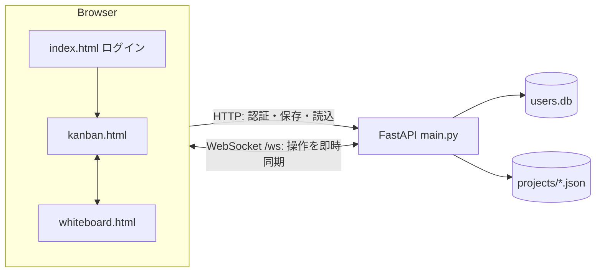

# KanFlow

リアルタイム共同編集の **かんばんボード & ホワイトボード**。
同じプロジェクトに入っている全員の操作（タスクの移動、付箋、手書き）が、WebSocketで即座に反映されます。

個人制作です（企画・設計・フロントエンド・バックエンドをすべて一人で担当）。動作確認は、友人に協力してもらい複数人で行いました。

## 機能

**かんばんボード（`kanban.html`）**
- ToDo / 進行中 / 完了 の3列。カードをドラッグ&ドロップで移動
- 優先度、タグ、期日（期限切れ・今日まで・明日までのバッジ）、担当者、コメント
- 「自分のタスク」だけに絞り込み

**ホワイトボード（`whiteboard.html`）**
- 手書き（ペン・消しゴム・色・太さ）、テキスト、付箋（色・文字サイズ・ドラッグ・リサイズ）、画像の配置
- 元に戻す / やり直し（Ctrl+Z / Ctrl+Y、最大60件）、ズーム

**共通**
- ユーザー登録・ログイン
- プロジェクト単位の切り替え・保存・自動保存。プロジェクトごとに別の「部屋」で同期

## 技術構成

| | |
|---|---|
| フロントエンド | HTML / CSS / JavaScript（フレームワークなし） |
| バックエンド | Python / FastAPI（HTTP API + WebSocket） |
| アカウント | SQLite（ソルト付きSHA-256でパスワードを保存） |
| 保存データ | プロジェクトごとのJSONファイル（`projects/`） |



## 動かし方

Python 3.9 以上が必要です。

```bash
python -m venv .venv
source .venv/bin/activate      # Windows: .venv\Scripts\activate
pip install -r requirements.txt
uvicorn main:app --host 0.0.0.0 --port 8000
```

ブラウザで http://localhost:8000 を開き、「新規登録」からアカウントを作ります。
同じネットワークの別の端末からは `http://<このPCのIPアドレス>:8000` で入れます（共同編集を試せます）。

`users.db` と `projects/` は初回起動時に自動で作られます（Gitには含めていません）。

## 仕組みと工夫したところ

**1. プロジェクトごとの「部屋」と、送信者以外への配信**
`join_project` で部屋に入ると、サーバーが現在の状態を `sync_state` でまとめて送ります。その後の操作は、同じ部屋の**自分以外**にだけ配信します（送った本人は画面を先に更新済みのため）。

**2. 保存を止めない（デバウンス + スレッドプール）**
操作のたびにファイルへ書くと重くなるため、最後の操作から500ms待ってまとめて保存します。書き込みはスレッドプールで実行するので、保存中もWebSocketの処理が止まりません。

**3. 接続が切れにくい**
サーバーが20秒ごとにpingを送り、無通信による切断（NATやプロキシのタイムアウト）を防ぎます。それでも切れた場合、クライアントは1.5秒後に自動で再接続します。

**4. 手書きの同期**
ストロークは `draw_stroke` で他の人に配信し、全体のスナップショット（`canvas_snapshot`）はサーバーに保存します。後から入った人は、保存済みの絵を `sync_state` で受け取ります。

**5. 同時編集の扱い**
同じ付箋やカードを同時に操作した場合は、**後から届いた操作で上書き**します（Last-Write-Wins）。実装は単純ですが、少人数で使う範囲では十分でした。

**6. 他の人から届いた文字列を、そのままHTMLに入れない**
タスク名・コメント・付箋のテキスト・ユーザー名など、他のクライアントから届く文字列は、HTMLに入れる前にエスケープしています。

### WebSocketメッセージ

| 種類 | メッセージ |
|---|---|
| 部屋 | `join_project`（入室）、`sync_state`（サーバー→本人に全体を送信） |
| かんばん | `add_task` `move_task` `delete_task` `add_comment` |
| 付箋 | `add_sticky` `move_sticky` `update_sticky` `resize_sticky` `delete_sticky` |
| テキスト・画像 | `add_text` `move_text` `update_text` `delete_text` / `add_image` `move_image` `delete_image` |
| 手書き | `draw_stroke`（配信のみ）、`canvas_snapshot`（保存のみ）、`clear_drawing`、`clear_all` |
| その他 | `project_list_changed`（接続中の全員に配信）、`ping` / `pong` |

### HTTP API

| | |
|---|---|
| `POST /auth/register` `POST /auth/login` | アカウント登録・ログイン |
| `GET /projects` | プロジェクト一覧 |
| `POST /projects/{name}/save` `GET /projects/{name}/load` `DELETE /projects/{name}` | 保存・読み込み・削除 |

## 既知の制限

学習用の制作として、次の点は意図的に割り切っています。実際に公開サービスとして使う場合は対応が必要です。

- **認証が簡易:** ログイン後にトークンを発行せず、ブラウザにユーザー名を保存するだけです。WebSocketやプロジェクト削除のAPIにも認証はありません
- **CORSを全許可**しています（`allow_origins=["*"]`）
- **パスワードのハッシュがSHA-256の1回**です。本番ではbcryptやargon2などの、計算コストを調整できる方式にすべきです
- **保存はJSONファイルで、状態はサーバーのメモリ上**に持っています。サーバーを複数台・複数プロセスにする構成は想定していません
- このリポジトリに**自動テストは含まれていません**
